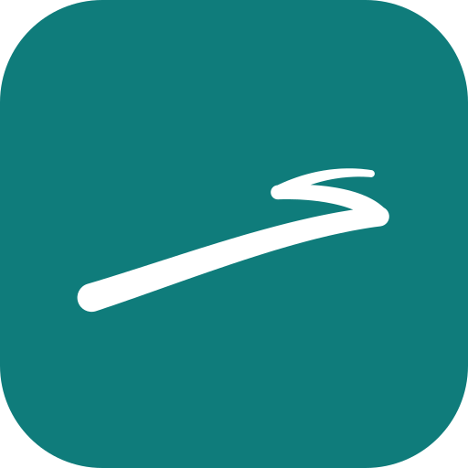

# Tableau de bord familial — SV

POC d'un tableau de bord familial à afficher en continu sur un grand écran
(pensé pour le **Samsung Smart Monitor M7 32"** sous Tizen, mais marche dans
n'importe quel navigateur et sur téléphone).

**Version actuelle : 1.1.0**

## Ce qu'il affiche

- 🕐 **Horloge + date** en français, mise à jour chaque seconde
- ☀️ **Météo** en direct (actuelle + 4 jours) — via l'API gratuite Open-Meteo, sans clé
- 🗓️ **Saint du jour** — calendrier français embarqué, fonctionne hors ligne
- 🏖️ **Compte à rebours** avant les prochaines vacances scolaires
- ✅ **Pense-bête / corvées** (données de démo pour l'instant)

Le tout habillé à la charte **SV** officielle, en thème sombre : couleurs, polices
(Manrope pour le texte, JetBrains Mono pour les chiffres) et le **geste** SV, qui se
dessine sur l'écran de lancement puis reste en petit dans le pied de page.

Sur grand écran (≥ 1200 px de large), les cartes passent en 2×2 et remplissent tout l'écran.

## Contenu du dépôt

| Fichier | Rôle |
|---|---|
| `tableau-bord-familial.html` | L'appli entière (HTML + CSS + JS commentés) |
| `assets/logos/sv-mark.svg` | Le geste SV seul (couleur réglable) |
| `assets/logos/sv-icon.svg` | Icône SV claire (tuile teal) |
| `assets/logos/sv-icon-dark.svg` | Icône SV sombre (sert d'icône d'onglet) |

## Utilisation

Ouvrir `tableau-bord-familial.html` dans un navigateur. C'est tout : un seul
fichier, aucune installation.

## Personnalisation

Tout se règle dans le bloc `CONFIG` en haut du `<script>`, à la fin du fichier HTML :

- `latitude` / `longitude` / `ville` — pour la météo
- `vacances` — liste des dates de vacances (Zone C par défaut), à mettre à jour chaque année
- `corvees` — le pense-bête (temporaire, en attendant le NAS)

## Prochaines étapes (idées)

- [ ] Brancher le pense-bête et le calendrier sur le NAS Synology (édition depuis le téléphone)
- [ ] Récupérer les dates de vacances automatiquement (API education.gouv.fr)
- [ ] Empaqueter en appli Tizen (`.wgt`) pour l'installer sur le M7
- [ ] Ajouter : menu de la semaine, anniversaires, planning qui-fait-quoi

## Historique

- **1.1.0** — Vrai logo SV (le geste), écran de lancement animé, charte SV officielle, mise en page 2×2 pour grand écran.
- **1.0.0** — Premier POC.

## Licence

Projet personnel.
